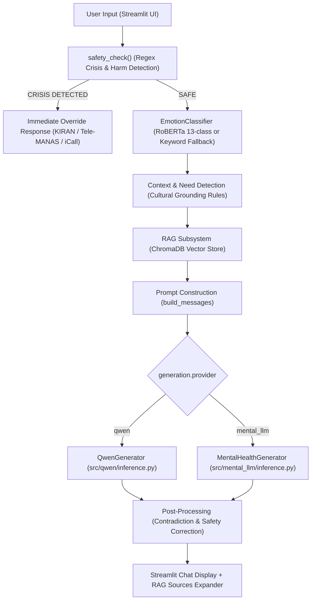

# Mental Health LLM Integration Guide

This document describes the integration of specialized mental-health language models into the **Emotion-Aware, Culturally Grounded AI Counselling Chatbot**.

---

## 1. Overview & Architecture

The chatbot generation pipeline supports pluggable model providers via configuration:
- **`qwen`**: The existing lightweight local model (`Qwen/Qwen3-0.6B` or fine-tuned `Qwen3-8B` with LoRA).
- **`mental_llm`**: Specialized language models fine-tuned specifically for psychological counselling and emotional support.

### Pipeline Flow



> [!IMPORTANT]
> **Safety Independence**: The safety layer (`src/chatbot/safety.py`) executes **before** any language model is invoked. If crisis keywords or harmful intentions are detected, the system immediately returns verified helpline numbers (KIRAN 1800-599-0019, Tele-MANAS 14416) without forwarding the prompt to the generator.

---

## 2. Model Candidates & Hardware Feasibility Analysis

### Candidate 1: `klyang/MentaLLaMA-chat-7B`
- **HuggingFace Repository**: [`klyang/MentaLLaMA-chat-7B`](https://huggingface.co/klyang/MentaLLaMA-chat-7B)
- **Base Architecture**: `LlamaForCausalLM` (fine-tuned from Meta LLaMA-2-chat-7B on mental health instruction data)
- **Parameters**: ~6.7 Billion
- **License**: MIT Model Card + LLaMA-2 Community License
- **Storage Size**: ~27 GB (`pytorch_model.bin` chunks)
- **Memory Requirements**:
  - FP32: ~27–28 GB RAM
  - FP16: ~14 GB RAM
  - INT8 / INT4: 5–8 GB (requires `bitsandbytes` GPU CUDA kernels)
- **Feasibility Verdict**:
  - **CPU-only (16 GB RAM)**: ❌ **Not Feasible**. Attempting to load 14 GB of FP16 weights on a 16 GB Windows machine crashes or locks system memory due to the OS overhead (~4–5 GB) and existing processes.
  - **CUDA GPU (>= 16 GB VRAM)**: ✅ **Feasible**. Fully supported by setting `model_id: "klyang/MentaLLaMA-chat-7B"` and `device: "cuda"` in `configs/chatbot.yaml`.

---

### Candidate 2: `ShivomH/Falcon3-1B-MentalHealth` (Primary CPU Candidate)
- **HuggingFace Repository**: [`ShivomH/Falcon3-1B-MentalHealth`](https://huggingface.co/ShivomH/Falcon3-1B-MentalHealth)
- **Base Architecture**: `LlamaForCausalLM` (`tiiuae/Falcon3-1B-Instruct` base)
- **Fine-Tuning Dataset**: `marmikpandya/mental-health` (counselling dialogues, emotional distress management)
- **Parameters**: 1.67 Billion
- **License**: Apache-2.0
- **Storage Size**: ~3.3 GB (`model.safetensors`)
- **Memory Requirements**:
  - FP32: ~6.7 GB RAM
  - FP16: ~3.4 GB RAM
- **Feasibility Verdict**:
  - **CPU-only (16 GB RAM)**: ✅ **Fully Feasible**. Fits comfortably inside 16 GB RAM alongside the RoBERTa emotion classifier (~500 MB) and sentence-transformers embedding model (~300 MB).

---

## 3. Configuration & Switching Providers

Configuration is managed in [`configs/chatbot.yaml`](file:///d:/Agentic%20AI/configs/chatbot.yaml):

```yaml
# Switch active generation backend
generation:
  provider: qwen # Change to "mental_llm" to activate the mental health model

mental_llm:
  model_id: "ShivomH/Falcon3-1B-MentalHealth"
  device: "auto" # "auto", "cpu", or "cuda"
  torch_dtype: "auto" # "auto", "float32", "float16", "bfloat16"
  trust_remote_code: false
  max_new_tokens: 256
  temperature: 0.7
  top_p: 0.9
  repetition_penalty: 1.05

  # For GPU environments with >= 16 GB VRAM, you can use:
  # model_id: "klyang/MentaLLaMA-chat-7B"
  # torch_dtype: "float16"
```

---

## 4. Sequential Comparison & Evaluation Scripts

To prevent Out-Of-Memory (OOM) errors when evaluating multiple models on a 16 GB machine, sequential memory management is enforced:

### 1. Compare Models
Runs test prompts through Qwen first, cleans up memory, and then runs through Mental LLM:
```bash
.venv\Scripts\python.exe scripts/compare_models.py
```
Output results are saved to: `outputs/chatbot/model_comparison.json`.

### 2. Evaluation Suite
Tests response quality across 10 mental health scenarios (stress, academic pressure, grief, relationships, crisis safety, etc.):
```bash
.venv\Scripts\python.exe scripts/evaluate_mental_llm.py --provider qwen
.venv\Scripts\python.exe scripts/evaluate_mental_llm.py --provider mental_llm
```
Output results are saved to: `outputs/chatbot/evaluation_<provider>.json`.

---

## 5. Automated Unit Tests

Unit tests use mock tokenizers and models so they execute instantly without downloading multi-gigabyte model weights:
```bash
.venv\Scripts\python.exe -m pytest tests/ -v
```

Verified test coverage:
1. `TestMentalHealthGenerator` (initialization, generation, streaming, metadata reporting)
2. `TestProviderSelection` (defaults, config toggles)
3. `TestSafetyIndependence` (ensures crisis keywords override any generation model)
4. `TestSyntaxValidity` (ensures all modules and app compile without errors)
5. `TestModelComparisonHelpers` (prompt formatting and exception handling)
6. `TestEvaluationSuiteChecks` (empathy detection, no-diagnosis checks, crisis hotline validation)
