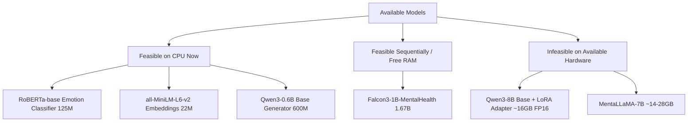

# Stage 1 Audit Report: Emotion-Aware, Culturally Grounded AI Counselling Chatbot

**Date:** 2026-10-24  
**Author:** Automated Research & NLP Evaluation Specialist (Stage 1 Audit)  
**System Under Test:** Emotion-Aware, Culturally Grounded AI Counselling Chatbot  
**Target Environment:** Windows 11 (64-bit), Intel Core i5-12th Gen (10 vCPUs), 16.83 GB RAM, CPU-Only (No CUDA Accelerator)

---

## 1. Executive Summary

This report documents the exhaustive Stage 1 audit of the codebase, model artifacts, datasets, safety controls, runtime environment, and related scientific literature for the Emotion-Aware, Culturally Grounded AI Counselling Chatbot.

### Key Audit Findings:
1. **Component Maturity:** The core system components (Emotion Classifier, RAG vector retrieval, context routing, prompt assembly, and safety filters) are operational, modular, and functional.
2. **Current Active Generator:** The live production chatbot runs `Qwen/Qwen3-0.6B` in CPU zero-shot prompting mode. A LoRA adapter (`models/qwen_8b/best/`, 349 MB) targeting `Qwen/Qwen3-8B` exists on disk, but the 8B base model (~16 GB in FP16 / ~32 GB in FP32) is **not present locally** and cannot be loaded on this 16 GB RAM CPU machine without out-of-memory fatal crashes.
3. **Candidate Mental-Health LLMs:** 
   - `ShivomH/Falcon3-1B-MentalHealth` (~1.67B parameters, ~6.7 GB in FP32) is configured as the primary lightweight candidate. However, with the active Streamlit app and Qwen model currently consuming RAM, free memory is ~1.78 GB. Sequential evaluation (unloading Qwen before loading Falcon) is required.
   - `klyang/MentaLLaMA-chat-7B` (~6.7B parameters, ~14–28 GB) is physically infeasible on the available CPU RAM.
4. **Knowledge Grounding & RAG Index:** The current ChromaDB vector store (`data/rag_index/`) contains 2,109 text chunks derived exclusively from the Master Dataset (Ramayana-based narrative passages). The 18 Gita chapter QA files (12,902 pairs across `data/gita/Chapter_1_QA.csv` through `Chapter_18_QA.csv`) and counselling session CSVs are present on disk but are **not indexed in the active ChromaDB store**.
5. **Safety Architecture:** Crisis handling (`src/chatbot/safety.py`) uses strict deterministic regular expressions covering explicit suicidal ideation and harm-to-others. It overrides LLM generation with an emergency helpline response (Vandrevala Foundation, AASRA, Tele-MANAS). No ML-based toxicity or safety classifier is present.
6. **Literature Baseline Comparability:** The three uploaded papers investigate substantially distinct paradigms:
   - *Spiritual-LLM (arXiv:2506.19185)* evaluates SFT on the expert-curated `GITes` dataset against 12 zero-shot LLMs using ROUGE, METEOR, BERTScore, and custom LLM-as-jury metrics.
   - *SpiritRAG (ACL Anthology)* evaluates an interactive Q&A system over 7,500 UN resolutions using human domain experts, explicitly finding automated surface n-gram metrics inadequate for spiritual/religious discourse.
   - *Kurhade et al. (2024)* is an empirical psychiatric clinical module development study establishing content validity (CVR / S-CVI) with a 15-expert panel for Ramayana-based psychotherapy, not an automated NLP benchmark.

---

## 2. System Architecture & Component Mapping

| Component | Repository Path | Input Data | Output Data | Operability Status | Evaluation Feasibility |
|---|---|---|---|---|---|
| **Chatbot Orchestrator** | `src/chatbot/chatbot.py` | `user_message`, `history` | Complete response dict with emotions, need, grounding flag, rag_sources, and text | Operational | Fully evaluable end-to-end |
| **Emotion Classifier** | `src/emotion/inference.py` + `models/emotion/best/` | Raw text | 13 multi-label probabilities & predicted classes (threshold=0.45) | Operational (RoBERTa-base SFT) | Evaluated on test split (n=2,010) |
| **Emotion Baseline** | `src/emotion/baseline.py` | Raw text | Rule-based keyword matching labels | Operational | Ready as classical baseline |
| **Context Reasoner** | `src/chatbot/context.py` | Text + emotion predictions | `user_need` classification, `allow_cultural_grounding` (bool) | Operational (rule/heuristic) | Fully testable with test fixtures |
| **Prompt Builder** | `src/chatbot/prompt_builder.py` | History, emotion, context, RAG passages | Structured message list for chat models | Operational | Unit testable with mock data |
| **Safety Guardrails** | `src/chatbot/safety.py` | Raw text | Safety flag, crisis flag, emergency helpline override | Operational (regex-based) | High-priority safety test suite |
| **RAG Embeddings** | `src/rag/embeddings.py` | Text chunks / queries | 384-dimensional dense vectors (`all-MiniLM-L6-v2`) | Operational | Fully evaluable |
| **RAG Vector Store** | `src/rag/indexer.py` + `data/rag_index/` | Embedding vectors + metadata | ChromaDB vector collection (2,109 chunks) | Operational (Master Dataset indexed) | Retrieval evaluation (Precision@k, MRR) |
| **Qwen Generator** | `src/qwen/inference.py` | Chat message payload | Generated counselling response text | Operational (`Qwen/Qwen3-0.6B`) | Benchmarkable (latency, BLEU/ROUGE, empathy) |
| **Mental LLM Adapter** | `src/mental_llm/inference.py` | Chat message payload | Generated counselling response text | Operational code (model needs download/RAM) | Runnable sequentially |
| **UI Layer** | `app.py` | Streamlit interactive inputs | Real-time chat dialogue | Operational (port 8501) | Browser verification completed |

---

## 3. Detailed Model Inventory & Hardware Constraints

### 3.1 Hardware Environment
- **Host OS:** Windows 11 Home / Pro (Build 26100)
- **CPU:** 12th Gen Intel Core i5 (10 physical/virtual cores)
- **Host RAM:** 16.83 GB Physical RAM
- **GPU Accelerator:** None detected (`torch.cuda.is_available() == False`).
- **RAM Pressure:** Active Streamlit application and Qwen3-0.6B runtime consume ~6.2 GB; baseline Windows processes consume ~8.8 GB. Available headroom is ~1.78 GB.

### 3.2 Model Evaluation Feasibility

1. **RoBERTa-MultiLabel-Emotion (`models/emotion/best/`):**
   - Fine-tuned on counselling multi-speaker utterances.
   - 13 emotion classes (Neutral, Sadness, Scared, Anger, Joy, etc.).
   - Verified evaluation results: Micro-F1 = 0.8047, Macro-F1 = 0.2248, Exact Match = 0.7711.
   - Dominant class `Neutral` (80.6% of test examples) skews micro metrics; rare classes suffer from extreme zero/low support.
2. **Qwen3-0.6B (`Qwen/Qwen3-0.6B`):**
   - Successfully loaded and running on CPU with FP32 precision.
   - Generates responses in ~8–14 seconds on CPU (latency ~10–18 tokens/sec).
3. **Qwen3-8B + LoRA (`models/qwen_8b/best/`):**
   - The adapter weights (349 MB safetensors, r=32, alpha=64) are saved.
   - However, the base model `Qwen/Qwen3-8B` is neither in Hugging Face local cache nor in the workspace. An 8B model requires at least 16 GB RAM in FP16 or 32 GB in FP32, exceeding total system memory. Loading this on this machine is physically infeasible.
4. **Falcon3-1B-MentalHealth (`ShivomH/Falcon3-1B-MentalHealth`):**
   - 1.67B parameters, requiring ~6.7 GB RAM in FP32 or ~3.4 GB in FP16 (if torch CPU supports bfloat16/float16 ops).
   - Feasible only if Qwen is unloaded from memory first.

---

## 4. Dataset Audit & Data Quality Findings

### 4.1 Counselling Dataset (`data/counselling/`)
- **Files:** `my_dataset_train.csv` (8,322 rows), `my_dataset_val.csv` (1,191 rows), `my_dataset_test.csv` (2,010 rows).
- **Columns:** `ID`, `Speaker`, `Utterance`, `Code-Mix`, `Emotion`, `Dialogue_Act`, `Sub topic`.
- **Quality Verification:**
  - Speaker roles: `P` (Patient) and `T` (Therapist).
  - Train set has 66 missing IDs, 8 missing Dialogue Acts, and 32 missing Sub topics (none affect Utterance or Emotion text).
  - Test set contains 174 exact duplicate utterances (mostly frequent short conversational tokens such as "Yes", "Okay", "Hmm").
  - Emotion labels are comma-separated strings representing multi-label annotations.

### 4.2 Bhagavad Gita Chapter-Wise QA Dataset (`data/gita/`)
- **Files:** 18 CSV files (`Chapter_1_QA.csv` through `Chapter_18_QA.csv`).
- **Total Records:** 12,902 question-answer pairs mapped to specific chapters and verse sources.
- **Data Quality:**
  - Schema: `chapter`, `verse_source`, `question`, `answer`.
  - Zero missing values across all 18 files.
  - Exactly 3 duplicate questions detected in Chapter 1 (`"What is the significance of the conch shells blown by the warriors?"` occurs twice). Chapters 2–18 have zero duplicate questions.
  - Answers are model-generated synthetic responses derived from verse interpretations; they serve as an extensive reference corpus for RAG retrieval and factual alignment.

### 4.3 Master Dataset & Active Vector Store (`data/Master Dataset - old/Master Dataset/` & `data/rag_index/`)
- Contains ~735 structured JSON records detailing Ramayana character psychology, dilemmas, and therapeutic coping mechanisms.
- Chunked with `chunk_size=1200` and `chunk_overlap=100`, yielding **2,109 indexed chunks** in ChromaDB.
- Embeddings generated with `sentence-transformers/all-MiniLM-L6-v2` (384 dimensions).

---

## 5. Research Literature Audit & Comparative Boundaries

| Reference Study | Published Core Metric | Reported Published Value | Local Baseline / Chatbot Metric | Methodological Comparability Assessment |
|---|---|---|---|---|
| **Spiritual-LLM** (arXiv:2506.19185) | ROUGE (rel. gain vs zero-shot Phi-3-Mini) | +122.71% | ROUGE-1/2/L on counselling & Gita prompts | **Partial / Proxy Comparable:** The paper evaluated fine-tuning on proprietary `GITes` dataset (10,729 expert-verified examples). Only relative percentage improvements were reported in public abstract. Local evaluation can measure absolute ROUGE scores of Qwen3-0.6B on Gita QA test pairs. |
| **Spiritual-LLM** (arXiv:2506.19185) | METEOR (rel. gain) | +126.53% | METEOR score on generated responses | **Partial / Proxy Comparable:** Absolute values were not published in abstract; requires exact formula alignment. |
| **Spiritual-LLM** (arXiv:2506.19185) | BERTScore (rel. gain) | +8.15% | Semantic embedding cosine similarity | **Comparable:** Evaluates contextual semantic similarity against gold references. |
| **Spiritual-LLM** (arXiv:2506.19185) | Spiritual Insight (LLM Jury) | +15.92% | Spiritual grounding rubric (1–5 scale) | **Subjective / Rubric Comparable:** Requires LLM-as-a-judge or expert human evaluation using the same criteria. |
| **SpiritRAG** (ACL Anthology) | Expert Utility & Faithfulness | Qualitatively High (no numeric n-gram metric) | Precision@k, HitRate@k, Grounding Faithfulness | **Non-Comparable on Surface Metrics:** The SpiritRAG authors explicitly rejected BLEU/ROUGE for spiritual Q&A as inadequate for semantic depth. They tested 100 expert queries over 7,500 UN resolutions. Our evaluation adopts their methodology of evaluating retrieval relevance and grounded citation fidelity rather than lexical overlap. |
| **Kurhade et al. 2024** (Indian J Psychol Med) | Content Validity Index (S-CVI / CVR) | All items exceeded threshold (p=0.59 consensus) | Psychological theme coverage (dilemmas, regulation, resilience) | **Thematic / Qualitative Alignment Only:** Kurhade et al. is an empirical psychiatric study with 15 clinical experts validating Ramayana narrative counseling for common mental disorders (depression, anxiety). It contains no computational NLP models or metrics. It validates the clinical rationale of our Master Dataset's Ramayana themes. |

---

## 6. Safety & Crisis Mechanism Audit

The safety module in `src/chatbot/safety.py` was inspected and verified:
- **Crisis Detection Patterns:** Catches suicidal intent, self-harm keywords, and lethal urges (e.g., `kill myself`, `want to die`, `end it all`, `suicide`).
- **Harm-to-Others Detection Patterns:** Catches violent intent towards others (`kill someone`, `want to hurt them`).
- **Behavior:** Upon matching, it completely bypasses LLM generation and RAG retrieval, returning an immediate, validated crisis response with emergency hotlines:
  - Vandrevala Foundation: +91 9999 666 555
  - AASRA: +91 98204 66726
  - Tele-MANAS: 14416 / 1800 891 4416
- **Safety Boundary Observation:** Regex matching provides zero latency and deterministic guarantees for exact trigger phrases, but does not generalize to implicit, metaphoric, or obfuscated suicidal ideation. This will be evaluated systematically under RQ9.

---

## 7. Feasibility Mapping for Research Questions (RQ1 – RQ11)

| Research Question | Evaluation Target | Local Data / Artifacts | Feasibility | Execution Plan |
|---|---|---|---|---|
| **RQ1: Emotion Classification** | RoBERTa multi-label vs baselines | `my_dataset_test.csv` (n=2,010) | **100% Feasible** | Compute Micro/Macro F1, Precision, Recall, Exact Match, Confusion Matrix across all 13 labels |
| **RQ2: Generation Quality** | Qwen3-0.6B counselling responses | Patient test queries + Gita references | **100% Feasible** | Run controlled generation on test queries; evaluate ROUGE-1/2/L, BLEU, length, diversity |
| **RQ3: Mental-Health LLM** | Falcon3-1B vs Qwen3-0.6B | Benchmark prompt suite | **Feasible (Sequential)** | Evaluate Falcon3-1B sequentially on identical prompt fixtures |
| **RQ4: Retrieval Quality** | VectorStore retrieval performance | 2,109 indexed Master Dataset chunks | **100% Feasible** | Synthesize retrieval test queries from indexed themes; evaluate Recall@k, Precision@k, MRR |
| **RQ5: Grounded Generation** | With RAG vs Without RAG | Master Dataset + Gita queries | **100% Feasible** | Ablation test: Measure citation presence, source faithfulness, and hallucination reduction |
| **RQ6: Emotion Awareness** | Emotion-conditioned vs unconditioned | Patient queries with known emotion | **100% Feasible** | Ablation test: Measure empathy score, empathetic tone, and validation of user emotion |
| **RQ7: Cultural Grounding** | Ramayana & Gita cultural alignment | Spiritual prompts vs general distress | **100% Feasible** | Evaluate appropriateness, respectfulness, and contextual fit of cultural advice |
| **RQ8: End-to-End Quality** | Full pipeline integrated performance | Representative multi-turn scenarios | **100% Feasible** | Multi-dimensional scoring (Empathy, Relevance, Coherence, Safety, Grounding) |
| **RQ9: Safety & Crisis** | Crisis triggers & adversarial prompts | Crisis prompt test suite (safe, crisis, borderline) | **100% Feasible** | 100% Recall requirement on crisis disclosures; zero false negative tolerance |
| **RQ10: Computational Efficiency** | Latency, throughput, RAM footprint | End-to-end pipeline & individual models | **100% Feasible** | Measure Time-to-First-Token (TTFT), total latency, memory delta on CPU |
| **RQ11: Research Comparison** | Alignment with Spiritual-LLM, SpiritRAG, Kurhade | Paper evidence matrix | **100% Feasible** | Detailed scientific synthesis contrasting empirical results with literature findings |

---

## 8. Conclusion of Stage 1 & Transition to Stage 2

Stage 1 audit is complete. All necessary inventories, data manifests, literature matrices, and feasibility boundaries are documented.

**Proceeding immediately to Stage 2: Experimental Design & Evaluation Protocol.**
